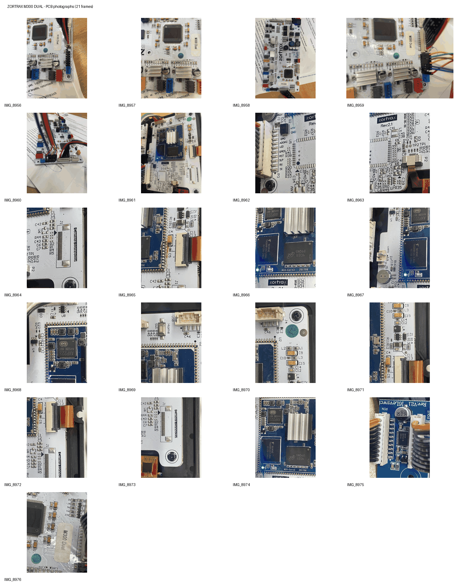

# M300 Dual — board photo archive

## Download

[**M300 Dual board photos — 21 PNG files (7.2 MB)**](M300_Dual_Photos_21_PNG_GitHub_compact.zip)

The file is stored directly in this independent M300 Dual repository. SHA-256: `cd41cecc17b8090a58867699e0c3630d6a5c30da71d25021bb52941721da4103`.

## Scope and pending additions

The downloadable ZIP contains images **IMG_8956–IMG_8976**. The contributor subsequently supplied **27 further photographs** in two batches, **IMG_8997–IMG_9024 (without IMG_9000)**. These additional image bytes have *not yet been successfully published to GitHub*, and the archive must not be represented as the complete 48-photo set.

The images document:
- Zortrax **Dual Motherboard V3.4** STM32 motion controller;
- Allwinner **A33-Core3** Android/display module and Zortrax Rev. 2.1 carrier;
- USB/power daughterboards, eMMC, J5 UART0 and P3 inter-board connectors.

Photo conversions remove camera EXIF/GPS metadata. The original factory firmware is not included.

## Additional information and collaboration

See [PCB and diagnostic notes](../../docs/PCB_AND_DIAGNOSTICS.md).

If you require additional measurements, higher-resolution PCB photographs, connector pinouts or other board information, please contact [@MarcinKowalik-AGH](https://github.com/MarcinKowalik-AGH).
